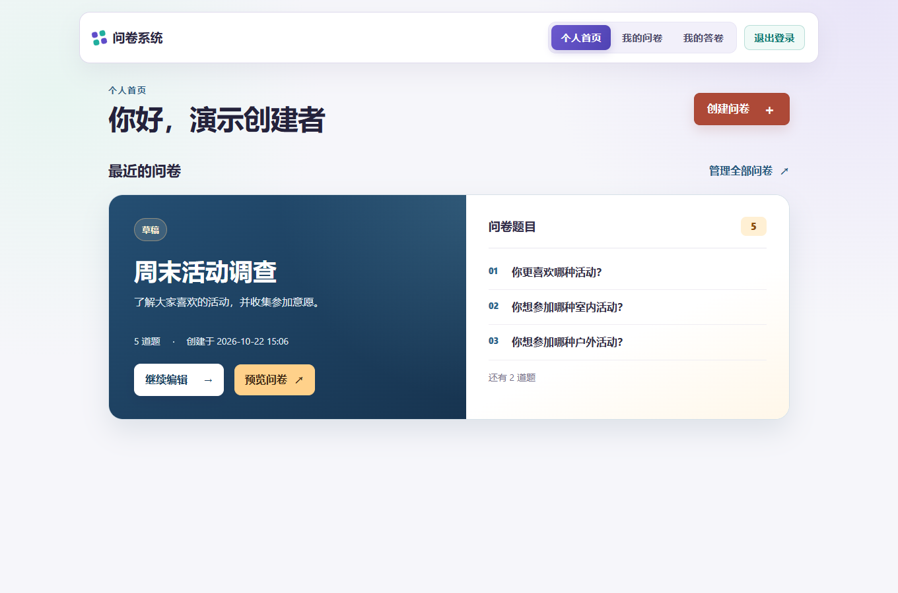
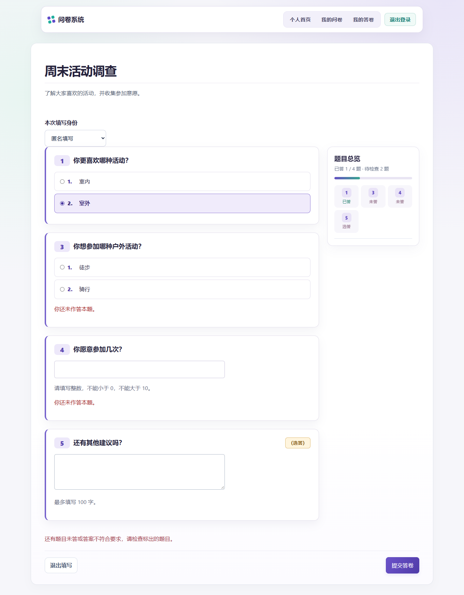
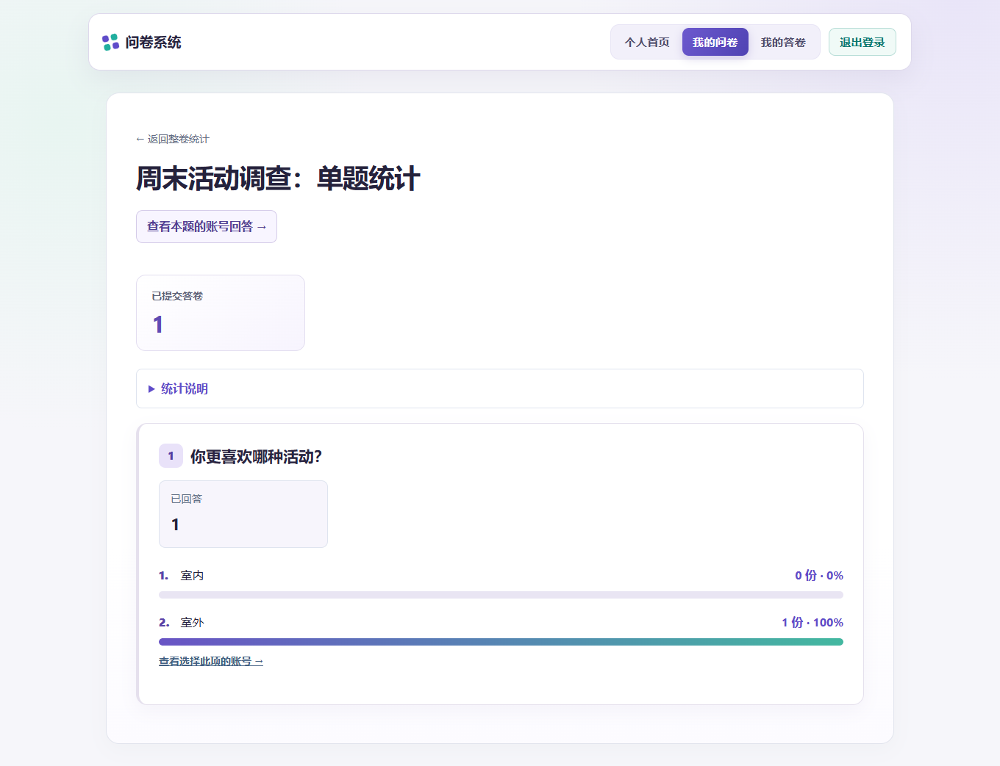

# 在线问卷系统第一阶段完成报告

代码仓库：[https://github.com/ctasr/online-survey-system-phase1](https://github.com/ctasr/online-survey-system-phase1)

## 项目目标

本项目完成了第一阶段的在线问卷系统。用户注册、登录后，可以创建问卷、设置题目和跳转规则，再发布问卷供其他用户填写。创建者可以查看整份问卷和每道题的统计结果。代码、测试与结果分别保存在仓库的`app/`、`tests/`和`output/`中。本报告只记录第一阶段已完成的内容。


代码在`app/`目录，运行入口是`run.py`。依赖和配置方法见`requirements.txt`、`.env.example`和`README.md`。公网演示地址是`https://119.28.27.184/`，问卷分享链接使用同一服务器的`/survey/<slug>`路径。填写者需要登录，问卷也必须处于可填写状态。本地地址`127.0.0.1`只供本机调试，不能发给外部用户。

## 系统设计

第一阶段的网页和JSON接口都由Flask提供，业务数据保存在MongoDB。账号、问卷、答卷和未提交草稿分开存储，问卷中的题目与跳转规则按顺序保存。创建者先编辑草稿，再发布分享链接。填写者登录后作答，提交时服务器重新计算条件跳转并检查答案，创建者随后查看问卷统计和具名答卷。

系统设计的字段、索引、权限和取舍见[系统与数据库设计](系统与数据库设计.md)，接口及状态码见[API说明](../API.md)。具体实现位于`app/`，运行和配置方法见`README.md`，测试步骤与结果见[测试用例与结果](测试用例与结果.md)。本报告只说明主要设计和验证结果，不重复逐项列出课程要求与文件路径。

后端使用Flask。网页和JSON API共用题目、跳转、校验和统计代码。用户登录后可以创建、编辑和发布问卷。填写者通过分享链接进入问卷，创建者可以查看统计结果和具名答卷。填写页面有题目总览，长问卷可以按题定位，统计页面可以切换到表格。页面提示便于用户改正答案，最终仍由服务器检查。

代码按功能分开。`app/auth.py`处理注册和登录，`app/surveys.py`处理问卷、填写和答卷查看，`app/questions.py`检查题目设置与答案，`app/jumps.py`计算跳转，`app/statistics.py`生成统计结果，`app/api.py`提供JSON接口。网页和API调用相同的校验代码，避免两种填写方式得到不同结果。

问卷先保存为草稿。创建者添加题目和跳转规则，预览后发布。填写者作答并提交，创建者查看统计结果。只有创建者能修改、关闭自己的问卷和查看统计，分享链接不提供管理权限。填写者提交前可以查看题目总览、返回修改并检查漏答。确认提交后，答卷只能查看，不能修改。匿名填写仍需登录，只是提交时不向创建者显示账号。题目很多时，可以使用搜索、分页、总览或表格，不必从头滚到尾。



## MongoDB设计

MongoDB使用`users`、`surveys`、`responses`和`response_drafts`四个集合。题目和跳转规则按顺序保存在问卷文档中，答卷单独保存。用户名、问卷分享标识和受限重复提交都有唯一索引。字段、BSON示例和索引见[MongoDB schema](MongoDB-schema.md)，设计理由见[系统与数据库设计](系统与数据库设计.md)。

| 集合 | 关键字段 | 与其他集合的关系和用途 |
| --- | --- | --- |
| `users` | `_id`、`username`、`password_hash`、`created_at` | 保存账号，只存密码散列，用户名唯一。 |
| `surveys` | `_id`、`owner_id`、`slug`、`status`、`created_at`、`published_at`、`revision`、`questions[]`、`question_history[]` | `owner_id`指向创建者，内嵌有序题目、限制与跳转，公开标识`slug`唯一。 |
| `responses` | `_id`、`survey_id`、`respondent_id`、`answers[]`、`submitted_at`、`viewer_key` | 每次提交独立存储，具名答卷可关联账号，匿名答卷的`respondent_id`为`null`。答案带题目ID和版本。 |
| `response_drafts` | `survey_id`、`user_id`、`answers`、`revision`、`updated_at` | 未提交的临时填写内容，同一账号对同一问卷最多保留一条，不参与统计。 |

题目通常和问卷一起读取，所以保存在问卷文档中。答卷数量会不断增加，单独存放更便于查询和统计。数据库为用户名、问卷分享标识、问卷所有者和答卷所属问卷建立索引。每个账号对同一问卷只保留一份草稿。问卷限制只能填写一次时，数据库索引还会阻止并发重复提交。匿名答卷不保存可供创建者查看的账号ID，填写者仍可通过系统生成的标记找到自己的答卷。

不同题型有不同的设置字段，放在问卷文档中便于保存和读取。答卷会记录提交时使用的题目定义标识。题目修改后，系统保留本问卷旧答卷所需的旧定义，查看旧答卷时不会误用新选项。这不是独立题目的管理功能。问卷的创建时间与发布时间分别记录。账号、问卷和答卷数据保存在MongoDB中，应用密钥只用于登录会话等安全功能。

## 跳转设计

跳转规则保存目标的题目ID，只允许跳到后面的题目。单选题根据所选项跳转，多选题可以设置“包含任意选项”“包含全部选项”等条件，数字题可以设置数值比较条件。多条规则从上到下检查，使用第一条符合条件的规则。提交时，服务器重新计算实际需要回答的题目。跳过的题目既不用回答，也不会写进答卷。

例如，第1题询问活动类型。选择“户外”时，可以跳过只面向室内活动的第2题，直接进入第3题。选择“室内”时，则继续回答第2题。规则指向固定的题目ID，不依赖会变化的题号。没有符合条件的规则时，系统进入下一题。提交时，服务器根据当前题目和答案重新判断跳转，不直接采用网页或接口提交的题目路径。如果问卷在填写期间被修改，基于旧题目版本的提交会收到冲突提示，需要重新核对答案。



## 校验设计

服务器检查必答要求、选择题的选项、多选数量、文本字数、数字范围和整数要求。网页表单与JSON接口都不能绕过这些检查。问卷修改后，基于旧题目版本的提交会收到冲突提示。已提交的答卷不能修改，关闭或过期的问卷也不能再提交。

题目默认必答，页面只额外标出“选答”。检查只针对实际需要回答的题目。必答题未回答时不能提交，选答题可以留空，因条件跳转而跳过的题目不算漏答。单选题只能选一个已有选项，多选题还要符合最少、最多或固定选项数的设置。文本和数字题分别检查字数、范围及整数要求。页面先提示填写者改正，服务器再检查一次。提交前的确认框会说明答卷提交后不可修改。

统计结果根据已提交的答卷计算。单选题显示各选项的选择人数，多选题显示各选项被选择的次数，文本题显示原文和相同回答的次数。数字题默认显示各答案及人数。平均值等指标仍可查看，测量类题目也可以直接展示这些指标。创建者能查看具名账号的答卷，以及哪些账号选择了某个选项。匿名答卷只参与统计，不显示填写者身份。接口格式和状态码见[API说明](../API.md)。

## 测试结果

自动测试覆盖注册、权限、问卷创建与编辑、四类题目、条件跳转、答案检查、提交、匿名填写、重复填写限制、统计、版本变更、CSRF以及JSON API的实际HTTP请求。2026年10月21日运行完整测试套件，结果为`Ran 41 tests in 108.580s`、`OK`。2026年10月22日再次运行两次，结果分别为`Ran 41 tests in 111.070s`和`Ran 41 tests in 92.056s`，均为`OK`，退出码均为0。同日又在公网地址通过实际HTTP请求完成注册、登录、创建、加题、发布、校验、提交、读取答卷和统计的完整流程，随后删除临时问卷。各项测试的步骤、输入、输出和结果见[测试用例与结果](测试用例与结果.md)。33张流程截图的对应关系见[测试截图证据索引](测试截图证据索引.md)，运行输出见[测试运行记录](../output/测试运行记录.txt)。截图保存在`output/第一阶段_实际运行流程/`，题目较多时的页面检查保存在`output/大题量体验检查/`。

| 测试流程 | 实际输入和操作 | 实际输出与结论 | 页面证据 |
| --- | --- | --- | --- |
| 创建与题目 | 注册并登录创建者，建立问卷，添加单选、多选、文本和数字题 | 草稿及题目保存，题目顺序和规则可在管理页查看 | 截图02–09 |
| 条件跳转 | 第1题选择命中“跳到第3题”的选项 | 填写页跳过中间题，服务器只保存实际经过的题目 | 截图09、15 |
| 必答与限制 | 留空必答题、输入不满足选项数/字数/数字范围的答案 | 页面或API提示错误，非法答卷不入库 | 截图14、测试用例T05 |
| 提交与历史 | 填完当前路径，确认提交，再查看本人答卷 | 提交前出现不可修改确认，提交成功，题目及答案可读回 | 截图18–21、28 |
| 创建者与统计 | 创建者、具名填写者和匿名填写者分别登录并提交 | 创建者可查看具名账号、完整答卷和某选项的填写账号，匿名身份不显示 | 截图22–23、31–33 |
| JSON API | 两个独立Cookie会话经真实HTTP注册、建卷、发布、提交和读取统计 | 创建与提交返回201，读取返回200，非创建者访问私有资源返回404 | 测试用例T11及[运行记录](../output/测试运行记录.txt) |

完整自动测试使用本地独立的测试数据库，结束后清理测试数据。测试程序检查答卷是否写入、访问权限是否生效以及HTTP状态码是否符合预期，运行记录和页面截图保留供复核。公网HTTP流程另用临时账号验证了实际部署服务的主要操作，临时问卷及答卷已删除；这次公网验证没有覆盖各浏览器的完整人工交互。



演示数据包含“基础数学题问卷”和“足球兴趣与规则认知问卷”。8个演示账号分别回答了两份问卷，因此每份问卷有8份具名测试答卷。数学题故意使用不同答案，便于检查统计分布。足球问卷根据填写者自评的了解程度，进入不同深度的题目。这些答卷只用于测试，不能代表真实用户的知识或喜好。

## AI使用过程

本项目使用Codex辅助编写Flask程序、网页和MongoDB访问代码。开发时，我以创建问卷、填写、提交、查看答卷和统计结果的使用过程为目标，检查AI生成的页面与功能，再根据实际问题提出修改。完成实现后，我核对课程要求并整理测试和交付材料。

以下按系统方案、界面和统计整理设计要求及实现结果。我确定功能与页面应达到的效果，Codex负责实现，并依据检查意见调整。

### 一、系统目标与核心功能

| 编号 | 提示词 | AI生成的代码和结果 | 是否修改 | 修改及检查 |
| --- | --- | --- | --- | --- |
| 1 | 先建立一个可以实际运行的在线问卷系统。用户登录后创建并发布问卷，其他用户通过链接填写，提交后能够查看自己的答卷，创建者能够查看统计结果。账号、问卷和答卷要保存到MongoDB，网页、接口和数据库使用同一份数据，不能只做静态演示页面。题型、限制和跳转规则再分别实现并检查。 | `app/__init__.py`和`run.py`建立Flask入口，`app/db.py`建立数据库索引，`README.md`和`.env.example`给出运行配置。 | 是 | 后来我要求完整验证实际流程。AI增加`tests/test_full_journey.py`并保存页面截图，不能仅凭本地网页能打开或自动测试通过就声称体验合格。 |
| 2 | 先完成账号注册、登录和退出。登录后进入个人页面，每个人只能管理自己的问卷。账号信息要存入MongoDB，问卷管理操作要对应当前登录账号。 | `app/auth.py`实现注册、登录、退出，`app/templates/index.html`、`login.html`、`register.html`提供页面。 | 是 | 初版登录页的入口不够清楚。我后来要求调整按钮和内容的排列，并把重复的密码显示控件改成一个眼睛图标按钮，见`app/templates/_password_toggle.html`和`app/static/app.js`。 |
| 3 | 创建者需要创建、查看、编辑、发布、关闭和删除自己的问卷。问卷要有标题、说明、是否允许匿名、每个账号的填写次数与截止时间，发布后形成可分享的填写链接。 | `app/surveys.py`的`create_survey`、`edit_survey`、`publish`、`close`等处理状态，`app/templates/surveys/`提供页面。 | 是 | 实际检查编辑页后，我指出信息混在一起、日期输入不直观，AI才调整表单分组和日期快捷选择，创建时间与发布时间也已分开记录，已发布问卷优先显示实际发布时间。 |
| 4 | 问卷列表和详情中的时间要按实际用途显示。创建草稿的时间与实际点击“发布”的时间不是一回事，发布时单独记录发布时间，已发布问卷优先显示真正的发布时间。 | 最终文件：`app/surveys.py`、`app/templates/surveys/list.html`。曾把创建时间当成发布信息显示。 | 是 | `surveys.py`创建时写`created_at`，实际点击发布时写`published_at`，`list.html`对已发布问卷显示真正的发布时间，草稿才显示创建时间。`tests/test_surveys.py`覆盖发布流程。 |
| 5 | 发布后的问卷需要生成可跨网络访问的分享链接。本地调试地址只用于开发，公开链接应使用独立部署的服务器地址。我提供腾讯云轻量应用服务器，请将系统部署到该服务器，并让链接生成逻辑读取公开地址配置。 | `app/sharing.py`根据`PUBLIC_BASE_URL`生成分享链接。初版仍显示本机地址，无法供其他网络的用户打开。 | 是 | 系统部署到腾讯云服务器后，AI调整了链接生成逻辑。`tests/test_sharing.py`检查本机地址不会被误当成公开地址。 |
| 6 | 问卷应能添加单选、多选、文本填空和数字填空题。创建者能设定选项、多选数量、文本字数、数字范围及整数要求，填写者提交的答案必须符合每道题的设置。 | `app/questions.py`的`build_question`、`validate_answer`处理选项、多选项数、字数、数字范围，`question_new.html`生成编辑表单。 | 是 | 实际使用题目编辑器后，我指出“恰好选择”“必须选择数”等文案不自然，并要求选项移动、删除和预览。填写规则中的短条件还曾被句号割裂，后来一并改为自然的提示，AI后续修改编辑控件和文案，见`tests/test_questions.py`。 |
| 7 | 创建者要能自己配置单选、多选和数字题的条件跳转，不能把示例问卷的分支直接写死在代码中。不同答案可以进入不同的后续题目，跳转目标必须位于当前题目之后。 | `app/jumps.py`的`build_jump_rule`、`rule_matches`、`next_question_index`，`jump_new.html`提供设置页。 | 是 | 初版操作入口不够清楚，我后来要求目标更容易找、可返回前页，并检查规则顺序、重叠和失效问题，见`jump_warnings`、`tests/test_jumps.py`、`tests/test_jump_review.py`。 |
| 8 | 填写时根据当前答案决定实际题目路径，跳过的题目不算漏答，也不要求填写。无论答卷来自网页还是JSON接口，服务器都要根据问卷规则重新计算经过的题目并校验答案，不能直接采用提交端给出的路径或校验结果。提交成功后，只保存实际经过的题目及其答案。 | `app/surveys.py`的`validated_answers`、`assess_response`负责路径计算和答案校验，网页与`app/api.py`的JSON接口共用这套逻辑。 | 是 | 我检查了跳题后的提交结果，要求被跳过的题不进入漏答提示和答卷记录。`tests/test_submissions.py`、`tests/test_json_api.py`分别检查无效答案被拒绝、有效提交只保存实际经过的题目。 |
| 9 | 创建者应能查看整份问卷和每道题的统计。单选按选项人数、多选按选项被选次数、文本按实际回答、数字按适合题意的结果展示，统计必须从已提交答卷计算，不能用静态示例结果。 | `app/statistics.py`的`summarize_responses`从答卷重新计算，`statistics.html`、`_question_statistics.html`展示。 | 是 | 我检查后指出必答、选答和跳过题的统计用语不清，额外加入的填写路径分布也无助于分析答案。AI区分有效回答与选答未填，移除路径分布，并按题型和题量调整呈现方式。 |
| 10 | 为第一阶段的主要操作提供JSON接口：账号注册与登录、问卷创建和管理、题目与跳转规则设置、发布与关闭、填写前校验、提交答卷、读取答卷和统计结果。接口与网页使用相同的权限和答案校验。API说明应列出方法、路径、请求字段、响应示例和状态码，并用实际HTTP请求检查从注册到读取统计结果的流程。 | `app/api.py`实现`/api/v1`下的上述接口，`API.md`记录方法、路径、字段、状态码和示例。 | 是 | 我要求检查正常流程以外的权限错误和无效提交。`tests/test_json_api_http.py`使用两个独立Cookie会话发送HTTP请求，检查注册、创建、发布、作答、读取统计和越权访问；`tests/test_json_api.py`检查无效答案与冲突处理。 |

### 二、界面设计与填写流程

| 编号 | 提示词 | AI生成的代码和结果 | 是否修改 | 修改及检查 |
| --- | --- | --- | --- | --- |
| 11 | 为第一阶段系统统一设计视觉层级。页面以浅色背景和白色内容卡片承载正文，标题用深色，辅助信息用灰色，保证文字对比度。颜色按用途区分：导航选中和常规主按钮用紫色，首页重点卡片用深蓝色，创建入口用暖红色，管理操作用琥珀色，成功和分享信息用绿色，删除及错误用红色。各类信息不能只靠紫色和绿色区分，链接文字也要与背景有足够对比。首页、列表、编辑、填写、答卷和统计都使用一致的标题、卡片、按钮和提示层级。输入框、按钮要容易点击，窄屏时内容改为纵向排列，长页面提供明确的返回和定位入口。 | 最终文件：`app/static/style.css`、`app/static/experience.css`、`app/static/polish.css`。最初多个页面只有白色卡片、紫绿两色和长表单，不容易区分内容。 | 是 | AI修改了样式文件和公共页面`base.html`。我继续根据实际截图指出文字对比度不足、颜色过于重复等问题，要求再改。 |
| 12 | 个人首页顶部保留导航，下方左侧显示问候语，右侧放醒目的“创建问卷”。“最近的问卷”采用左右两栏卡片：左栏放状态、标题、简短说明、题数、创建或发布时间及当前最有用的操作，右栏只预览前三道题，其余用“还有几道题”提示，避免长问卷把首页撑满。题号独立占位并保持单行，长题目在旁边换行，不能把“03”挤成上下两个数字。其他问卷和“我的答卷”放在主卡片下方，有内容才显示，空状态直接给出创建入口，不要留下大片无用留白。窄屏时两栏改为上下排列，管理全部问卷要有清楚的入口。 | 最终文件：`app/templates/dashboard.html`、`app/templates/index.html`。初版首页的操作入口不显眼，卡片之间留白过多。 | 是 | AI调整了主要操作、最近问卷和答卷入口的布局。页面截图见`output/第一阶段_实际运行流程/04_个人首页.png`。 |
| 13 | 普通题目默认必答，不要在每道题旁边反复写“必答”。只有可以不回答的题目才标“（选答）”。题目编辑页和填写页都要按这个规则显示，避免同一道题在不同页面说法不一致。 | 最终文件：`app/templates/surveys/question_new.html`、`app/templates/surveys/public.html`。初版反复标出“必答”，真正需要提醒的选答题反而不醒目。 | 是 | 相关页面默认不显示“必答”，只给选答题加上“（选答）”。服务器仍按题目设置检查必答要求。 |
| 14 | 题目序号固定为数字，选择题的每个选项才可以选择用1、2、3、4或A、B、C、D编号。不要再把A/B/C/D当题号，管理页、预览、正式填写和统计页必须使用一致的题号与选项号规则。 | 最终文件：`app/numbering.py`、`app/templates/surveys/public.html`。初版将字母选项编号用在题目序号上。 | 是 | `app/numbering.py`分开`question_label`与`option_label`，题目编号固定为数字，选择题选项可选数字或字母。页面上还把题号放进独立编号块，与题目正文留出间距，避免长题目把编号挤成两行。`tests/test_answer_overview.py`检查这一点。 |
| 15 | 题目创建和编辑页的“取消”必须真的能返回，预览页也要有清楚的返回问卷入口。填写过程中应有回到前一步或退出的方式，避免用户依赖浏览器后退，未保存内容离开时给出恰当提醒。 | 最终文件：`app/static/app.js`、`app/templates/surveys/detail.html`。表单取消和预览返回入口不清楚。 | 是 | 题目编辑/创建、预览等页面增加明确的返回链接，表单未保存时的离开提醒由`app.js`处理。 |
| 16 | 填写者不要只能一题一题翻。提供题目总览，让用户随时看到当前路径上哪些题已答、哪些未答、哪些需要修改，并能直接定位到相应题目，条件跳转变化后，总览应同步更新。题目很多时还要有分页、回到顶部和退出填写的快捷入口，手机屏幕上也应容易使用。 | 最终文件：`app/templates/surveys/public.html`、`app/static/app.js`。初版逐题操作，长问卷难定位。 | 是 | `public.html`、`app.js`增加题目总览、已答/未答/需修改状态、跳题定位，并加入分页、回到顶部和退出填写的快捷操作。`tests/test_answer_overview.py`验证总览遵守跳转路径。 |
| 17 | 点击提交时检查实际路径上的必答题：未答或不符合限制就提示并阻止提交，用户改正后才能继续。提示尽量简洁，例如“你还未作答本题”，不要再次复制长题目或把已跳过的题列为错误。 | 最终文件：`app/questions.py`、`app/surveys.py`、`app/static/app.js`。初版错误信息重复题目内容，且可能把跳过题当成漏答。 | 是 | 提示缩为“你还未作答本题”，`app/questions.py`、`surveys.py`与前端评估只检查实际到达的必答题。`tests/test_submissions.py`检查无效答案不入库。 |
| 18 | 合法答卷提交前再让填写者确认一次，明确说明“提交后这份答卷不可修改”。取消确认不能写入答卷，确认后保存并显示提交成功，已提交的答卷只能查看不能编辑。 | 最终文件：`app/static/app.js`、`app/surveys.py`。原提交动作缺少最后确认，提示语也不准确。 | 是 | `app/static/app.js`在校验成功后显示确认对话框，文案为“提交后这份答卷不可修改”，后端只提供创建与读取答卷，不提供修改已提交答卷的接口。 |
| 19 | 删除问卷等重要操作不要使用浏览器原生弹窗。改成与系统风格一致的站内确认界面，清楚说明将删除问卷及其答卷，并允许取消，避免误操作。 | 最终文件：`app/templates/base.html`、`app/static/app.js`。删除问卷使用浏览器原生确认框，与页面风格不一致。 | 是 | `base.html`、`app.js`统一使用站内`<dialog>`确认，删除仍需用户确认，文案说明会删除问卷及答卷。 |
| 20 | “我的答卷”和创建者查看的单份答卷，都要显示完整题目和提交时的答案。选择题先清楚显示选中的内容，想看其他选项时也能展开。题目后来被修改，旧答卷仍应显示提交时的题目，不能拿新题目解释旧答案。“我的答卷”按名称查找时不应强制限定日期，日期筛选提供“今天”快捷选择。 | 最终文件：`app/templates/surveys/response_detail.html`。初版答卷内容过于简略，看不到完整题目和其他选项。 | 是 | 答卷页显示完整题目和已选答案，也能展开全部选项。答卷较长时可以分页，答卷列表的日期筛选也已调整。`tests/test_submissions.py`检查修改题目后的旧答卷。 |

### 三、统计与答卷查看

| 编号 | 提示词 | AI生成的代码和结果 | 是否修改 | 修改及检查 |
| --- | --- | --- | --- | --- |
| 21 | 如果一份问卷有几百道题，而且题目很长，管理页、填写页、答卷页和统计页就不能反复列出全部题目。请提供按题号或内容查找、简洁的表格、分页和单题详情。需要时仍要能看到完整题目。 | 最终文件：`app/templates/surveys/detail.html`、`app/templates/surveys/statistics.html`、`app/static/app.js`。初版在管理页和统计页反复列出长题，查找很费时。 | 是 | 管理页增加题目查找和分页，统计页增加表格、查找、分页和单题详情。`tests/test_statistics.py`和大题量页面截图检查题目较多的情况。 |
| 22 | 非匿名提交应让问卷创建者看到各账号的答题情况。请在统计或问卷管理中提供具名答卷列表，并能进入每个账号的完整答卷，匿名答卷只能计入统计，不显示可识别身份。 | 最终文件：`app/surveys.py`、`app/templates/surveys/statistics.html`。只有汇总比例，具名提交的作用没有体现。 | 是 | `surveys.py`增加`survey_account_responses`、`survey_account_response_detail`，`statistics.html`进入逐份具名答卷。匿名提交不暴露身份，见`tests/test_surveys.py`。 |
| 23 | 每一道题的统计也应方便创建者追查：点开某个选项、文本答案或数字答案时，能看到哪些具名账号给出该答案，并能进入对应完整答卷。大量回答时需要筛选和分页。 | 最终文件：`app/surveys.py`、`app/templates/surveys/_question_statistics.html`。从单题统计不能直接追到作答者。 | 是 | `_question_statistics.html`的选项/文本/数字结果链接至`question_account_responses`，按选项或原文筛选具名账号，该路由及分页在`surveys.py`。 |
| 24 | 数字题的统计重点应根据题目用途来定。数学题有正确答案，先展示每种答案和选择人数，不要把平均值放在最显眼的位置。也要考虑年龄、时长等测量题，不能只修数学题，却让其他问卷出现同样的问题。 | 最终文件：`app/questions.py`、`app/statistics.py`、`app/templates/surveys/_question_statistics.html`。初版把平均值作为所有数字题的主要结果，没有按题目用途区分展示重点。 | 是 | 数字题默认展示各答案的人数。创建者将题目设为测量类时，页面可以突出平均值。其他数字题也仍能查看平均值。`tests/test_statistics.py`用`81,81,72`检查分布与平均值。 |

### 代表性代码文件及作用

下面是最终代码中的关键语句节选，完整函数与上下文以对应源文件为准。

```python
# app/db.py：用户名、公开链接及“仅填一次”均用数据库索引保证唯一性
database.users.create_index("username", unique=True)
database.surveys.create_index("slug", unique=True)
database.responses.create_index(
    [("survey_id", 1), ("respondent_key", 1)],
    name="one_response_per_user_when_limited",
    unique=True,
    partialFilterExpression={"repeat_limited": True},
)
```

```python
# app/jumps.py：跳转规则按创建者设置的顺序命中
def next_question_index(questions, index, value):
    source = questions[index]
    later = {
        question["id"]: position
        for position, question in enumerate(questions)
        if position > index
    }
    for rule in source.get("jumps", []):
        target_index = later.get(rule.get("target_id"))
        if (
            target_index is not None
            and not rule_issue(source, rule, later)
            and rule_matches(rule, value)
        ):
            return target_index
    return index + 1
```

```javascript
// app/static/app.js：先评估漏答，再让填写者确认不可修改，最后才真正提交
const result = await assess(true);
if (result && !Object.keys(result.errors).length) {
  const confirmed = surveyFlow.dataset.preview === 'true' || await askConfirmation({
    title: '提交答卷？',
    message: '提交后这份答卷不可修改。',
    label: '确认提交',
    tone: 'primary'
  });
  if (confirmed) {
    if (draftSaving) await draftSaving.catch(() => {});
    surveyFlow.dataset.submitting = "true";
    HTMLFormElement.prototype.submit.call(surveyFlow);
    return;
  }
}
```

```python
# app/questions.py：多选题由服务器核验是否满足创建者设置的数量规则
if exact is not None and count != exact:
    raise ValueError(f"“{title}”请选择 {exact} 项。")
minimum = question.get("min_select")
maximum = question.get("max_select")
if minimum is not None and count < minimum:
    raise ValueError(f"“{title}”至少选 {minimum} 项。")
if maximum is not None and count > maximum:
    raise ValueError(f"“{title}”最多选 {maximum} 项。")
```

```python
# app/statistics.py：数字题既统计每个答案的份数，也保留原文件要求的平均值
frequencies = Counter(result["values"])
result["number_frequencies"] = sorted(
    frequencies.items(),
    key=lambda item: (-item[1], Decimal(item[0])),
)
average = sum(numbers, Decimal(0)) / len(numbers)
```

```python
# app/api.py：JSON API 与网页调用同一份统计计算逻辑
results, overview = summarize_responses(
    survey.get("questions", []),
    responses,
    survey.get("question_history", []),
    return_overview=True,
)
```

### AI使用说明

AI帮了什么：在我确定的功能流程、页面布局和规则要求下，Codex编写了应用代码、数据库索引、页面、JSON接口和文档，并根据检查意见调整实现。具体产出及保留的源文件见前面的使用记录。

AI做错了什么：初版曾混淆题号和选项编号，没有处理好必答与选答、数学题的统计重点、长问卷定位及具名答卷查看。实际页面还暴露出操作和排版问题。

自己改了什么：我检查实际页面，调整题号、填写流程、统计方式和分享链接的设计要求，并逐项指出需要修改的地方。足球问卷按了解程度分支，数字题按题意安排统计重点，匿名与具名答卷分清查看范围。Codex据此修改代码，我继续检查页面呈现。

自己设计了什么：我确定创建、填写、提交、查看答卷和统计的完整流程，规定题号与选项号的用法、默认必答而只标选答、按了解程度设置足球问卷分支，以及数字题按用途安排统计重点。界面上，我确定首页的信息顺序、题目预览数量、长问卷的定位方式和颜色的用途。跨网络分享采用独立服务器。MongoDB、题型和条件跳转属于课程要求，我负责将这些要求落实为可使用的问卷流程。


## 遇到的问题

开发和检查过程中，题目编号、条件跳转后的答案检查、长问卷浏览和统计展示都需要调整。题号与选项编号共用显示方式时容易看混，跳过的题目也不能按漏答处理。题目较多时，连续排列的页面不方便定位。统计页还需要区分不同题型的展示重点。部署时，本机地址无法供不同网络的用户使用，公网页面也曾出现访问故障。

## 如何解决

我将题号固定为数字，字母只用于选择题选项。普通题默认必答，仅标出选答题。填写页按实际跳转路径检查答案，长问卷增加搜索、分页和逐题定位，并提供提交前确认。Codex根据这些设计要求修改前后端代码。

统计中区分有效回答、选答未填和未包含本题，不展示无关的填写路径分布。具名答卷可以按账号、选项和答案查看，匿名身份不向创建者公开。数字题一般先展示答案分布，测量类题目可以突出平均值。

部署时使用独立公网服务器，本地地址只供调试。公网页面出现故障后，重新检查路由、模板和服务入口。调整后，公网首页与API入口均能正常访问。
